 

*Ambitious and dedicated, having originated in the holding cells of a shadowy facility, 
members of the Titanite Bloodline carry an honor handed down by SoulTitan.*

 

## The team

<table>
  <tr>
    <!-- German goes first, as Organisation Leader, once he has a GitHub account: copy a cell below. -->
    <td align="center">
      
      <h3>Ben</h3>
      Head of Innovation 
      <a href="https://github.com/CaptainBHH">@CaptainBHH</a>
    </td>
    <td align="center">
      
      <h3>Rolo</h3>
      Head of Finance 
      <a href="https://github.com/rola2410">@rola2410</a>
    </td>
  </tr>
</table>

