 

## The Team

<table>
  <tr>
    <td align="center">
      
      <h3>German</h3>
      Organisation Leader 
      <a href="https://github.com/healthygermanguy">@healthygermanguy</a>
    </td>
    <td align="center">
      
      <h3>Ardent</h3>
      Head of Innovation 
      <a href="https://github.com/CaptainBHH">@CaptainBHH</a>
    </td>
  </tr>
</table>

